# ginkgo-skills

Agent skills from the Ginkgo project, shared for anyone to read and use.

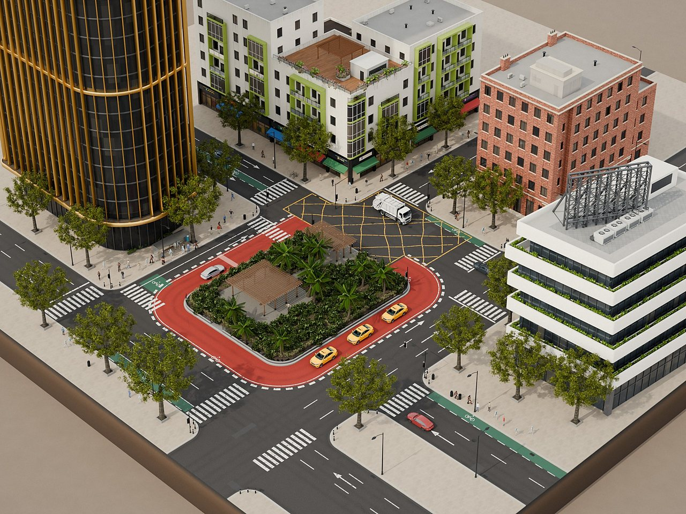

## photo-scene-reconstruction

`skills/photo-scene-reconstruction/SKILL.md` teaches an AI coding agent (written for Claude Code) to rebuild a
reference photo or concept image as a Blender scene that holds up side by side with the original, using:

- a multi-agent harness: one lead plus 4-6 domain agents, each owning one module and one layout file;
- a frozen, solved camera and a render-and-compare loop (overlay, edge and crop sheets after every change);
- a fixed fidelity order (read, silhouette, proportion, colour, small parts, wear) with gates;
- light and materials measured from the image instead of tuned by eye;
- a real-mesh rule for organic and object-like things (no primitive stand-ins);
- a ranked list of code-generation techniques for detailed, organic architecture (section 7): profile sweeps,
  Geometry Nodes kits, curve-driven facades, facade grammars, subdivision cages, SDF blends, volume terrain,
  code-grown plants, with what worked and what did not.

## Results: three worlds generated in code

Every building, road, pipe, cliff and tile below was generated by Python in Blender by a team of agents
(10 domains across three scenes), matched against an approved concept image. Generated meshes were used only
for vehicles, vending machines and a few shrubs.

**City junction**: a gold-fin tower, a stepped office, a lime-and-white residential block and a brick
mid-rise around a red taxi loop.

| | |
|---|---|
| 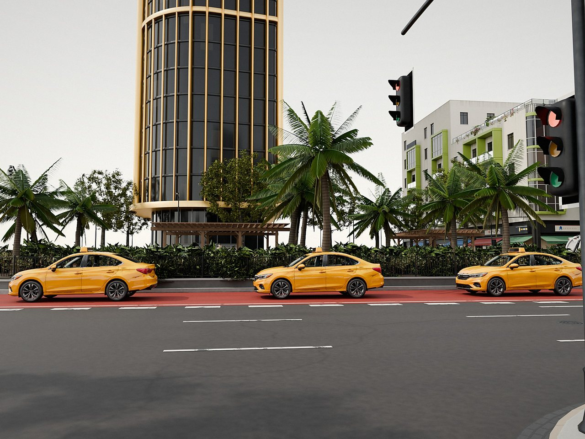 | 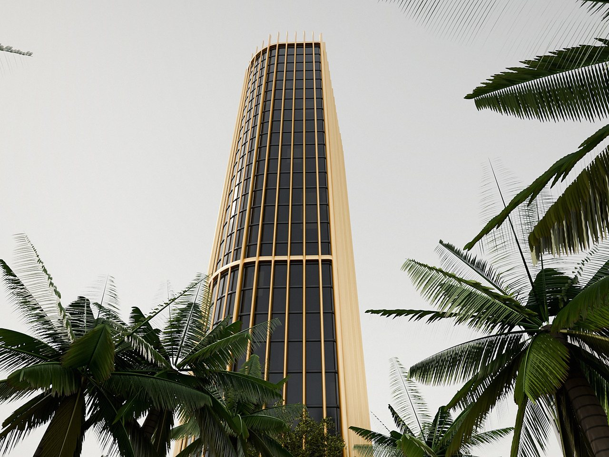 |

**Mint tile corner shop**: about 2,000 individually modelled, bevelled glazed tiles, swept canvas awnings, roll-down
shutters, poles, cables and mirrors.

| | |
|---|---|
| 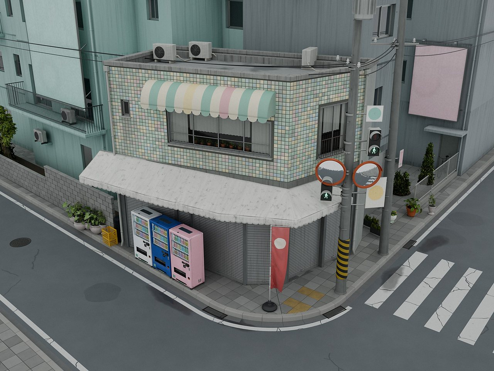 | 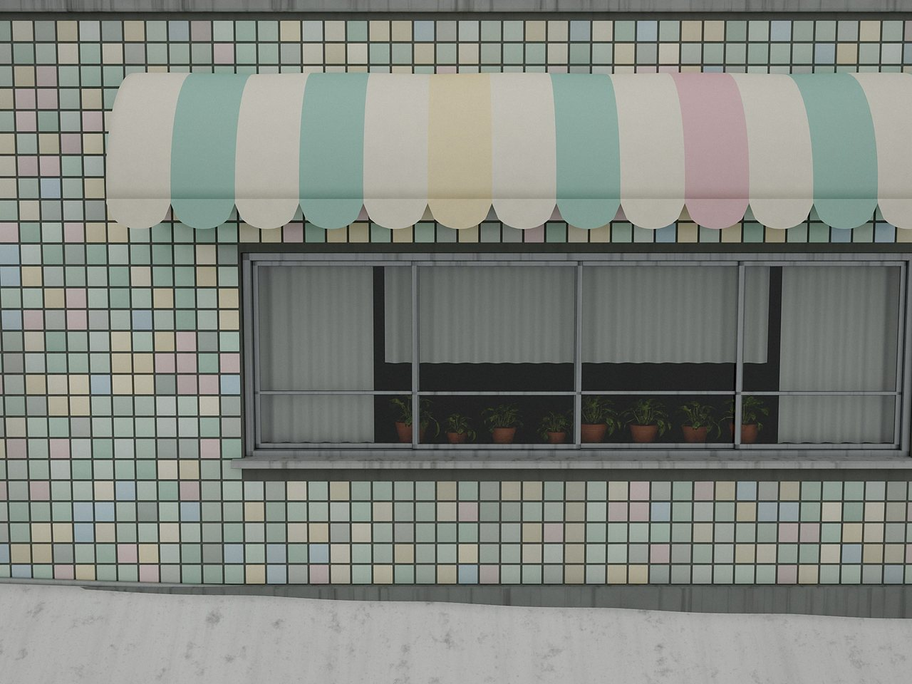 |
| 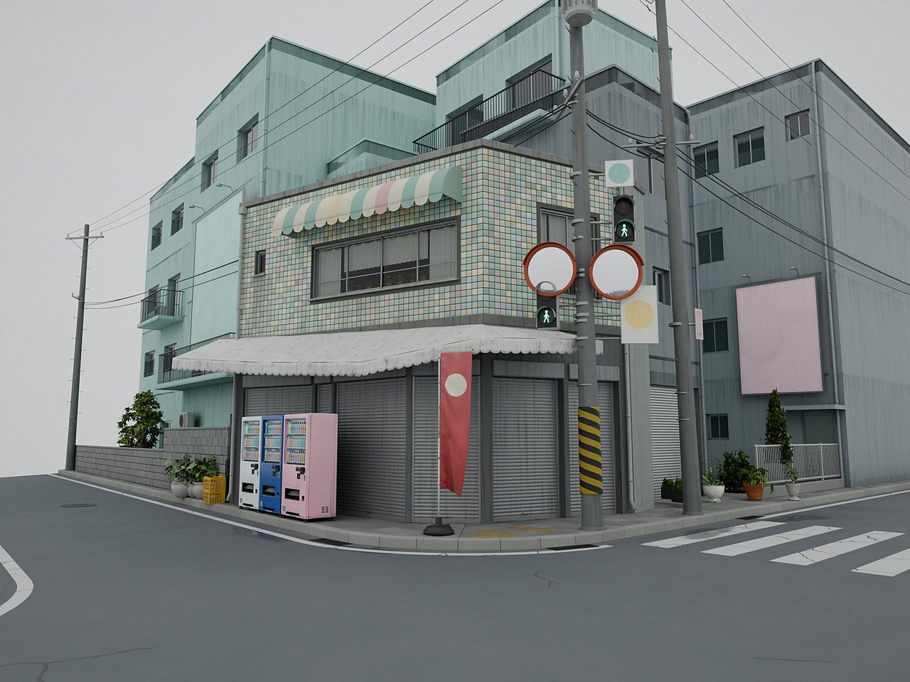 | |

**Cliffside pump station**: subdivision-cage modules, lofted spillways with algae weathering, a volume-meshed
basalt cliff, lathe-profile pipes on a laced trestle.

| | |
|---|---|
| 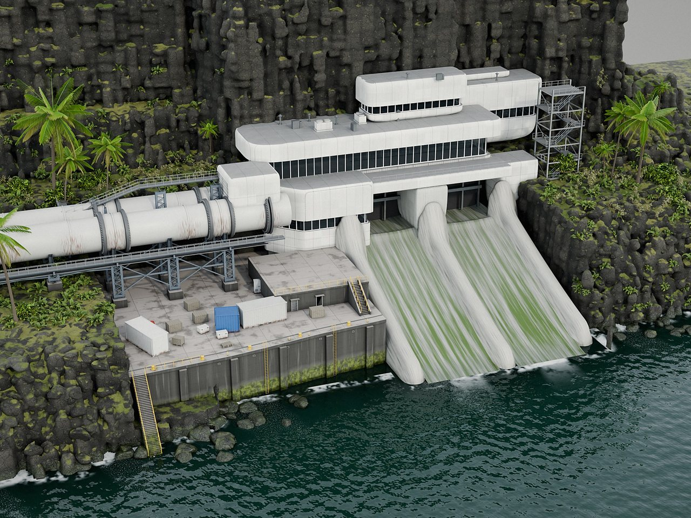 | 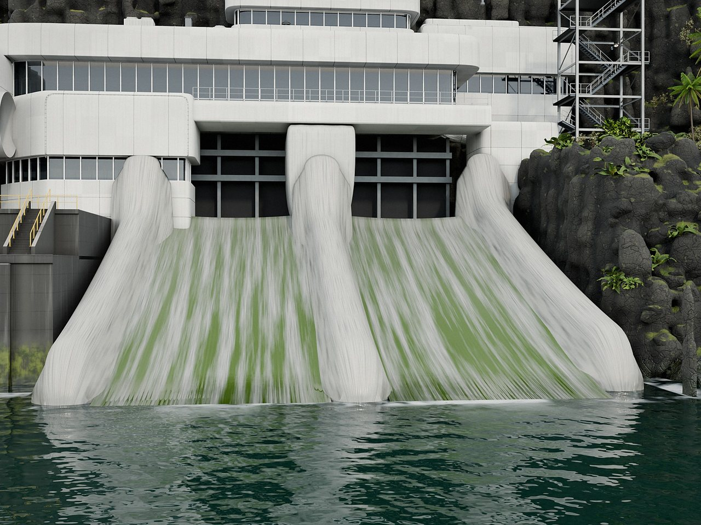 |
| 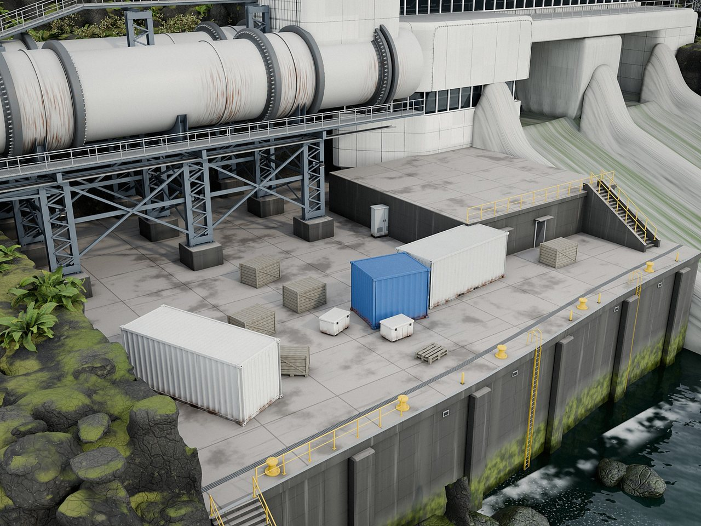 | |

## Which code-generation techniques worked (A/B evidence)

Each comparison shows the concept target on the left (where there is one), a naive box/extrude version, and the
code-generated version, from the same camera.

**Curve-driven facade system (T5):** ~140 aerofoil fins spaced by arc length on a least-squares-fitted rounded
plan, lofted through height stations with per-fin twist and depth.
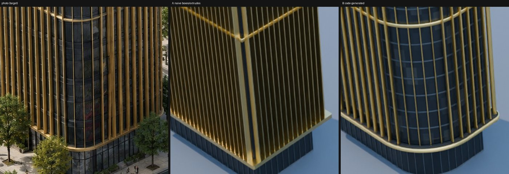

**Profile sweeps (T1):** balcony bands with drip grooves, chamfered lips and planters, about 3k triangles for
all five bands. The most detail per triangle of anything tried.
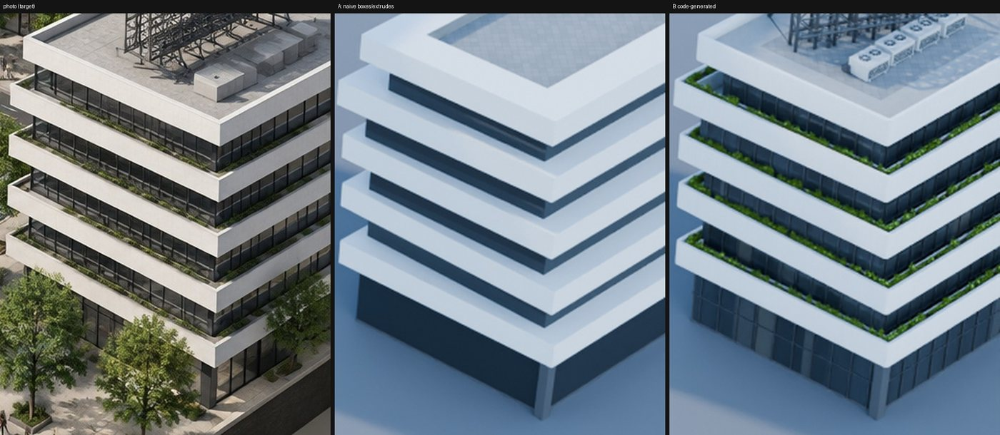

**Instanced kits via Geometry Nodes (T6/T2):** real bevelled tiles with grout recess and per-tile colour and tilt
(target | texture only | instanced tiles | displacement). Displacement cost three times the triangles and gave
softer grout.
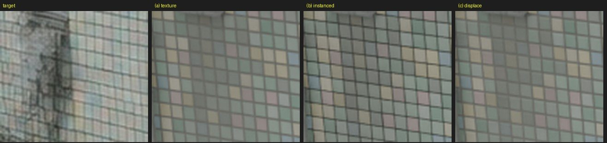

**Facade grammar + bay kit:** connected massings with chamfered lime bays, balconies and shopfronts.
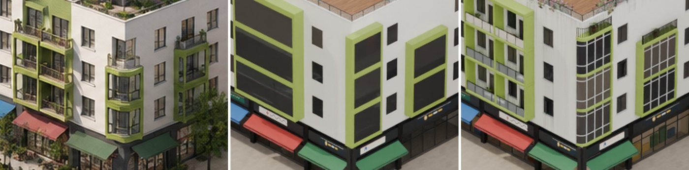

**Instanced slat kit:** pergola posts, joists, joints and slats against a two-box version.
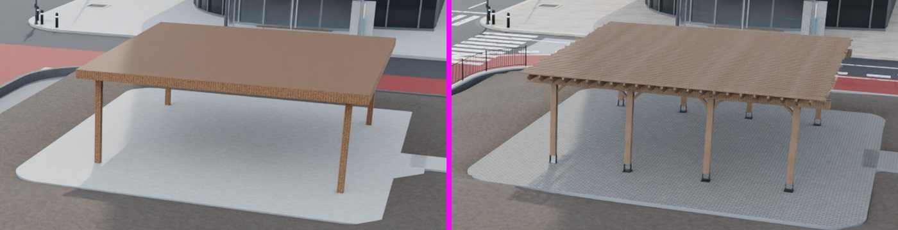

**Subdivision cages (T4) vs SDF fillets (T3):** naive boxes | subdivision cages | SDF volume blend. Cages won
for the modules (every radius controllable, crisp reveals, 2.3x fewer triangles); SDF won only where modules
flow into each other.
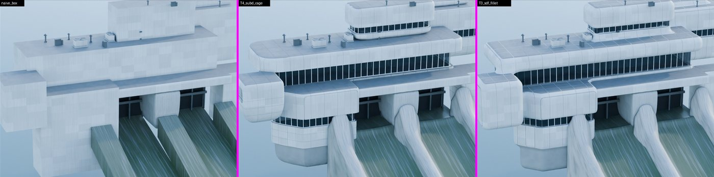

**Lofted spillways (T1):** slabs against lofts with crest lips and flared piers.
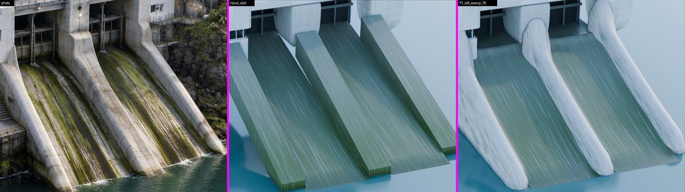

**Volume terrain:** a numpy density field meshed with surface nets, columnar basalt and erosion, against a
displaced plane.
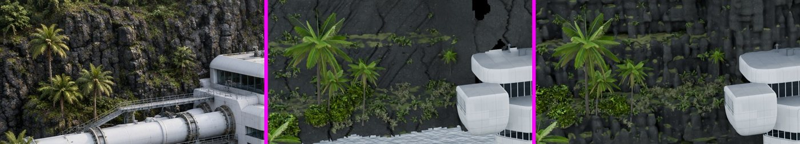

**Code-grown plants:** a code-grown palm (swept ring-scarred trunk, drawn alpha leaflets) read better than a
paid image-to-3D palm.
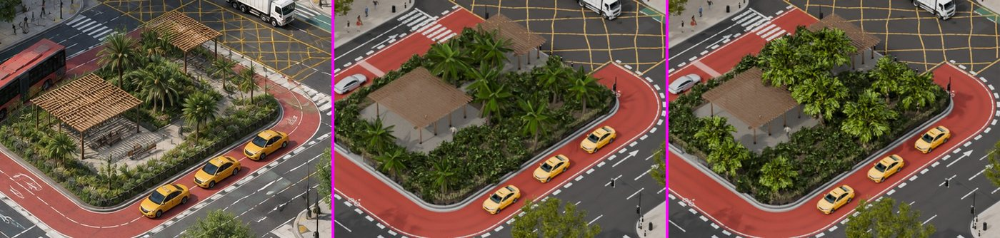

## Harness

`skills/photo-scene-reconstruction/harness/` holds the generic run scaffold: `blender/build_scene.py`
(orchestrator), `render.py`, `light.py`, `lib.py`, `assets.py`, and `tools/` (`cam.py` camera model,
`vp3.py` vanishing-point solver, `iterate.sh` build-render-compare loop, overlay/edge/crop/stats tools,
Poly Haven fetchers). Copy `blender/` and `tools/` into a run folder, add `ref/photo.jpg`,
`layout/camera.json`, `layout/order.json` and one `cg_<domain>.py` module per domain.

## Install

Copy `skills/photo-scene-reconstruction` into your project's `.claude/skills/` (or `~/.claude/skills/`).

Requirements: Blender 5.x (Cycles), Python with numpy, opencv-python and pillow for the 2D tools
(`tools/py.sh` uses `uv`), and Git Bash or another POSIX shell for `iterate.sh`.

## License

MIT, see `LICENSE`. The images in `docs/images/` are renders of scenes made with this method.
